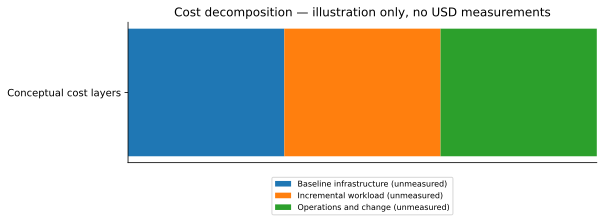

# InfraVita V2 | Evidence-driven Cost, Capacity & SLA Decision Prototype

**An evolving experimental prototype, not a production-ready product.** InfraVita V2 studies infrastructure behavior, operational cost exposure, service-level risk, and decision governance using reproducible AWS experiments and historical telemetry.

[Documentation hub](docs/README.md) · [Infrastructure deployment](docs/operations/INFRASTRUCTURE_DEPLOYMENT.md) · [Run the experiments](docs/operations/EXPERIMENT_EXECUTION.md) · [Measured results](docs/experiments/RESULTADOS_Y_ESTADISTICAS.md) · [Local vs Bedrock](docs/models/COMPARACION_LOCAL_BEDROCK.md) · [Limitations](docs/hackathon/INFORME_FINAL.md)

## The core economic question: what does the minimum running service cost?

**An idle service is not necessarily a zero-cost service.** Provisioned compute, attached storage, public IPv4 addresses (where applicable), monitoring, logs, network components and operational maintenance may create a baseline cost even at zero application traffic. Charges depend on the exact AWS resources, pricing dimensions and whether they remain provisioned or active; there is **no measured dollar amount for this baseline in the current experiments**.

A useful conceptual decomposition is:

\[ C_{total}(T)=C_{baseline}(T)+C_{workload}(T)+C_{operations}(T)+C_{change}(T) \]

Here, `C_baseline` is the cost of keeping the minimum deployable, connected and observable service available over time `T`; `C_workload` represents load-dependent usage; `C_operations` covers monitoring and support; `C_change` represents deployment, evolution and recovery work. **This is a conceptual model, not an AWS billing result.** The first next experiment should measure an idle baseline and then the incremental cost of controlled workload using actual billing/cost data.

## What was implemented and observed

| Historical evidence | Verified scope |
|---|---:|
| Experimental systems | EXP-001 HTTP/Locust; EXP-002 FastAPI/PostgreSQL |
| Campaigns / paired load scenarios | 4 / 20 |
| Local model / Bedrock inference executions | 20 / 20 |
| Unique CloudWatch observations / Linux SSM snapshots | 730 / 60 |
| Raw local–Bedrock agreement, EXP-001 | 8/10 (80%) |
| Raw local–Bedrock agreement, EXP-002 | 5/10 (50%) |
| Effective agreement after EXP-002 guardrails | 10/10 (100%) |

EXP-002 had **`sla_status=NOT_EVALUATED` in all ten cases**. Guardrails therefore prevented unsupported actionable decisions. The 100% effective agreement is policy convergence, **not evidence that both models reason identically**. One EXP-001 run had `execution_status=FAILED` even though its structured SLA status was `PASS`; these are distinct fields and must not be conflated.

## Why this is a prototype

The historical campaigns lasted roughly 60–120 seconds, with limited sampling. No production-scale reliability assessment, sustained saturation proof, independently verified monetary savings, formal EXP-002 SLA evaluation or autonomous remediation was completed. Recommendations are advisory and policy-controlled; the system does not automatically resize infrastructure.

**Demonstrated:** evidence ingestion, EC2/SSM/CloudWatch observability, local and Bedrock inference, paired comparison, traceable RUN_ID/hash, and deterministic safety guardrails.

**Next:** measured idle infrastructure cost, longer and repeated load campaigns, role-aware CPU/memory/headroom, AWS billing attribution, explicit SLA contracts, and decision validation before automation.

## Reading path

1. [Documentation hub](docs/README.md) — all chapters and provenance.
2. [Architecture and evolution](docs/architecture/VISION_Y_EVOLUCION.md) — components and future scope.
3. [Deploy infrastructure](docs/operations/INFRASTRUCTURE_DEPLOYMENT.md) and [execute campaigns](docs/operations/EXPERIMENT_EXECUTION.md) — AWS-active workflows, not required for historical review.
4. [Results and charts](docs/experiments/RESULTADOS_Y_ESTADISTICAS.md) and [telemetry analysis](docs/experiments/RESOURCE_UTILIZATION.md).
5. [Audit reports without inference](docs/models/TRAZABILIDAD_SIN_INFERENCIA.md) and [model comparison](docs/models/COMPARACION_LOCAL_BEDROCK.md).

> The original experiment infrastructure has been torn down. All figures in this documentation are derived from the preserved historical reports. Do not redeploy or incur AWS charges merely to read or validate the results.
