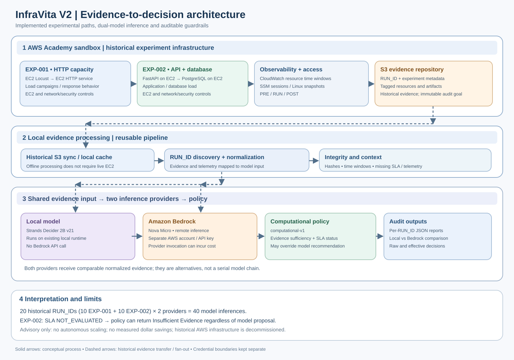

# Architecture, operational integrity and evolution

InfraVita V2 is an **experimental decision-support prototype** spanning the infrastructure/software lifecycle. Its current scope is evidence-backed capacity and SLA decision governance, not a fully deployed cost optimizer.


### Evidence-to-decision integration: local model and Amazon Bedrock



**The diagram shows the implemented logical workflow, not a live deployment.** EXP-001 used EC2 Locust and an HTTP EC2 service; EXP-002 used an EC2 FastAPI application and EC2 PostgreSQL. CloudWatch, SSM and Linux snapshots supplied observations; S3 was the required evidence repository. Historical `RUN_ID` artifacts can be processed from a local cache after the infrastructure has been decommissioned.

**Evidence flow.** Experimental telemetry, workload outputs and metadata are grouped by experiment and `RUN_ID`. The integration pipeline discovers available historical runs, normalizes observations, retains provenance and identifies missing data. The same normalized evidence context is provided to two **alternative** inference providers. This is not a local-model-to-Bedrock chain.

**Local inference.** `scripts/start_agent.sh` launches the existing local Strands Decider 2B runtime through the agent integration, using local historical evidence. The local provider does not require a Bedrock request. Exact runtime selection and installed model dependencies must be validated on the execution host; the diagram does not imply they are bundled in the repository.

**Bedrock inference.** The same analysis path selects `--provider bedrock` to invoke **Amazon Bedrock Nova Micro** remotely. Bedrock authentication belongs to a **separate AWS account** from the AWS Academy sandbox used for experiments and S3. Credential handling must remain external to Git; the repository must not store bearer tokens or API keys. `--offline` describes the **evidence source only**: combining `--offline` with `--provider bedrock` still makes a remote model call and may incur charges.

**Policy and outputs.** Both providers produce proposed recommendations. The `computational-v1` decision policy evaluates evidence sufficiency and SLA evaluation status before recording the **effective decision**. Model proposals must not be presented as approved infrastructure actions. JSON reports, per-run comparisons and provenance support audit and reproducibility.

| Stage | Input / boundary | Output / behavior |
|---|---|---|
| Experiments | EXP-001 HTTP/Locust; EXP-002 FastAPI/PostgreSQL | Workload and resource observations |
| Telemetry | CloudWatch, SSM Linux snapshots, experiment logs | PRE / RUN / POST and workload evidence |
| Historical storage | S3 with tagged resources and `RUN_ID` organization | Auditable historical artifacts |
| Local integration | Local cache; run discovery and normalization | Comparable model input with provenance |
| Local provider | Existing Strands Decider 2B v21 runtime | Proposed local recommendation |
| Bedrock provider | Separate-account API credentials; remote Nova Micro | Proposed remote recommendation |
| Policy | `computational-v1`; SLA and evidence checks | Effective, guarded decision |
| Audit | JSON reports and comparison CSV | Traceable differences between providers |

**Validated historical scope:** 10 runs per experiment, 20 distinct `RUN_ID`s and 40 model inferences across the two providers. These are historical results, not an indication of live infrastructure. For EXP-002, an unevaluated SLA can force **Insufficient Evidence** even when a model proposes Maintain or Optimize. No automatic scaling or measured financial savings are claimed.

**Example commands (run from the repository root; verify the installed environment first):**

```bash
bash scripts/start_agent.sh --check

bash scripts/start_agent.sh --offline --infer \
  --local-root experiments/exp001_capacity/results \
  --provider bedrock \
  --decision-policy computational-v1 \
  --output reports/bedrock/exp001_bedrock.json
```

The second command is **not fully offline**: it invokes Bedrock and can overwrite the specified report. Use a new output path for exploratory reruns, and load credentials using the repository's approved secure workflow. To execute the local provider, consult `docs/operations/GUIA_EJECUCION.md` and the supported options of `scripts/start_agent.sh` rather than assuming a provider alias.

## Components and trust boundaries

| Layer | Implemented evidence | Responsibility |
|---|---|---|
| Workload | EXP-001 HTTP/Locust; EXP-002 FastAPI/PostgreSQL | Produce controlled request load and service behavior |
| Infrastructure | EC2, network/security controls, SSM, S3 | Provision isolated experiments and preserve evidence |
| Telemetry | CloudWatch plus Linux snapshots via SSM | Observe resource usage, availability and service metrics |
| Integration | `scripts/start_agent.sh`, `src.agent.official_integration` | Discover historical RUN_IDs and normalize model input |
| Models | Local Strands Decider 2B v21; Bedrock Nova Micro | Propose recommendations; not ground truth |
| Decision policy | `computational-v1` | Override unsupported actions when evidence/SLA is inadequate |
| Audit | JSON reports, hashes, comparison CSV | Separate observation, model output and effective decision |

**Credential isolation:** AWS Academy credentials supported infrastructure/evidence operations; Bedrock used a separate AWS account/API key. The local `--offline` flag means evidence is read locally; `--provider bedrock` still makes a paid remote request.

## Cost baseline hypothesis

A provisioned minimum service can incur cost with zero workload. This depends on actual resource allocation and billing dimensions; no idle-cost USD figure was collected. A valid future test should compare an **idle but deployed** baseline against controlled load and a **deprovisioned** state, using billing data and a complete inventory. Do not interpret low CPU as zero cost or automatic right-sizing eligibility.

## System integrity first

Preserve evidence hashes, consistent experiment identifiers, role attribution, security boundaries, explicit SLA evaluation, and auditability. The system currently **advises only**. Automated scaling, consolidation, migration or retirement require approval, rollback and independently validated policy.

## Roadmap (not implemented in this MVP)

1. Measure idle compute/storage/network/monitoring baseline with cost allocation and billing reconciliation.
2. Run sustained stress, recovery and capacity experiments with finer time-aligned telemetry.
3. Attribute CPU, memory, I/O and costs to EC2 roles and service components.
4. Establish explicit SLA contracts and uncertainty-aware decisions.
5. Expand to enterprise applications, databases, data platforms, modernization and retirement decisions.
