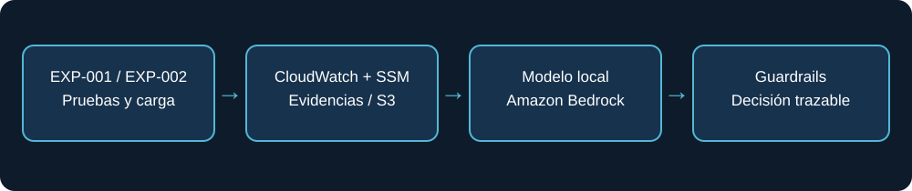

# Architecture, operational integrity and evolution

InfraVita V2 is an **experimental decision-support prototype** spanning the infrastructure/software lifecycle. Its current scope is evidence-backed capacity and SLA decision governance, not a fully deployed cost optimizer.

## Components and trust boundaries

| Layer | Implemented evidence | Responsibility |
|---|---|---|
| Workload | EXP-001 HTTP/Locust; EXP-002 FastAPI/PostgreSQL | Produce controlled request load and service behavior |
| Infrastructure | EC2, network/security controls, SSM, S3 | Provision isolated experiments and preserve evidence |
| Telemetry | CloudWatch plus Linux snapshots via SSM | Observe resource usage, availability and service metrics |
| Integration | `scripts/start_agent.sh`, `src.agent.official_integration` | Discover historical RUN_IDs and normalize model input |
| Models | Local Strands Decider 2B v21; Bedrock Nova Micro | Propose recommendations; not ground truth |
| Decision policy | `computational-v1` | Override unsupported actions when evidence/SLA is inadequate |
| Audit | JSON reports, hashes, comparison CSV | Separate observation, model output and effective decision |

**Credential isolation:** AWS Academy credentials supported infrastructure/evidence operations; Bedrock used a separate AWS account/API key. The local `--offline` flag means evidence is read locally; `--provider bedrock` still makes a paid remote request.

## Cost baseline hypothesis

A provisioned minimum service can incur cost with zero workload. This depends on actual resource allocation and billing dimensions; no idle-cost USD figure was collected. A valid future test should compare an **idle but deployed** baseline against controlled load and a **deprovisioned** state, using billing data and a complete inventory. Do not interpret low CPU as zero cost or automatic right-sizing eligibility.

## System integrity first

Preserve evidence hashes, consistent experiment identifiers, role attribution, security boundaries, explicit SLA evaluation, and auditability. The system currently **advises only**. Automated scaling, consolidation, migration or retirement require approval, rollback and independently validated policy.

## Roadmap (not implemented in this MVP)

1. Measure idle compute/storage/network/monitoring baseline with cost allocation and billing reconciliation.
2. Run sustained stress, recovery and capacity experiments with finer time-aligned telemetry.
3. Attribute CPU, memory, I/O and costs to EC2 roles and service components.
4. Establish explicit SLA contracts and uncertainty-aware decisions.
5. Expand to enterprise applications, databases, data platforms, modernization and retirement decisions.
