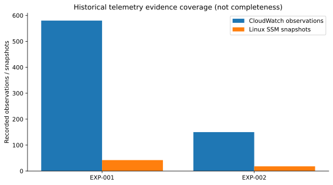

# Evidence matrix and provenance

| Source | Scope | Interpretation |
|---|---|---|
| `reports/local_model/exp001_local.json` | 10 EXP-001 local inferences | Observed evidence + local proposed/effective decisions |
| `reports/bedrock/exp001_bedrock.json` | 10 EXP-001 Bedrock inferences | Same RUN_ID/evidence hashes, different provider |
| `reports/local_model/exp002_local.json` | 10 EXP-002 local inferences | `sla_status=NOT_EVALUATED` |
| `reports/bedrock/exp002_bedrock.json` | 10 EXP-002 Bedrock inferences | Same evidence hashes; guardrails applied |
| `reports/comparison/comparison_by_run.csv` | 20 paired cases | Per-run SLA, p95, RPS, provider recommendations, override flags |
| `reports/comparison/comparison_summary.json` | Aggregate comparison | Derived statistics, not raw monitoring source |

Across **20 unique runs**, the reports record **730 CloudWatch observations** and **60 Linux SSM snapshots**. Do not double-count these because two inference providers processed the same inputs. The telemetry contracts contain sampled/aggregated CPU and memory measurements, not complete high-resolution time series.

See [Results](RESULTADOS_Y_ESTADISTICAS.md), [Resource utilization](RESOURCE_UTILIZATION.md) and [Integrity validator](../validation/validate_report_integrity.py).
