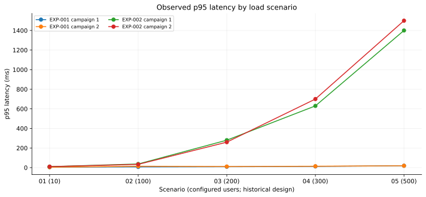
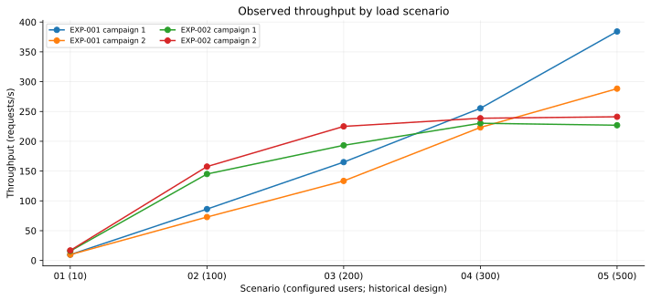
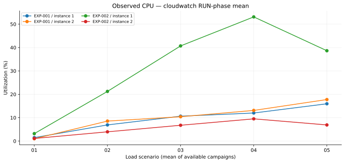
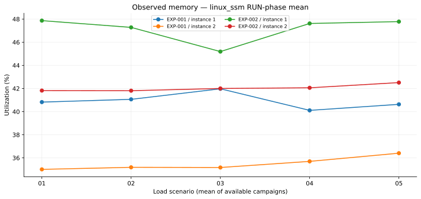

# Experimental results and descriptive statistics

**Source:** 20 paired historical RUN_IDs, four committed JSON inference reports, and `reports/comparison/comparison_by_run.csv`. These are short experimental runs, not a representative long-term production sample.

## Coverage

| Experiment | Unique runs | Campaigns | CloudWatch observations | Linux SSM snapshots | Structured SLA |
|---|---:|---:|---:|---:|---|
| EXP-001 | 10 | 2 | 580 | 42 | 10 PASS |
| EXP-002 | 10 | 2 | 150 | 18 | 10 NOT_EVALUATED |
| **Total** | **20** | **4** | **730** | **60** | — |

## Measured response behavior

| Experiment | p95 min (ms) | Median of run p95 values (ms) | p95 max (ms) | RPS min | RPS max |
|---|---:|---:|---:|---:|---:|
| EXP-001 | 4 | 11.5 | 19 | 9.78 | 384.23 |
| EXP-002 | 10 | 270 | 1500 | 15.84 | 241.10 |

The median shown is the median **across per-run p95 values**, not the global p95 of all requests. In EXP-002, p95 increases substantially toward DB-05 even though the recorded normalized error rate is 0. No formal EXP-002 SLA verdict exists.

## CPU and memory

These plots use the `telemetry_contract.measurements` records from the existing local-model JSON reports, **not inferred CPU saturation**. CPU uses CloudWatch `Average.mean`; memory uses Linux SSM `mean`. Each point is an aggregated short-window measurement, and instance identifiers are anonymized in chart labels. The available data do not establish stable resource headroom or sustained saturation. See [Resource utilization](RESOURCE_UTILIZATION.md).

## Provider recommendations

| Experiment | Raw local–Bedrock agreement | Effective agreement | Local overrides | Bedrock overrides |
|---|---:|---:|---:|---:|
| EXP-001 | 8/10 | 8/10 | 0 | 0 |
| EXP-002 | 5/10 | 10/10 | 4 | 8 |

EXP-002's 100% effective agreement is explained by the conservative `NOT_EVALUATED` SLA guardrail. It does not measure recommendation correctness.

## Important anomaly

EXP-001 scenario LB-04 in the first campaign has `execution_status=FAILED` while `sla_status=PASS`. These fields describe different aspects of the run and must be presented separately; neither should be silently corrected.

## Per-run source

The complete 20-row per-run matrix is `reports/comparison/comparison_by_run.csv` in the repository. Use it for exact run IDs, timestamps, evidence hashes, p95, throughput, error rates, observation counts and proposed/effective decisions. The chart generator is included in [`docs/images/generate_charts.py`](../images/generate_charts.py).

## Measurement limitations

- Short 60–120 second historical campaigns and sparse CloudWatch sampling.
- No verified AWS billing amounts or `infrastructure_cost` data; no cost-savings claim.
- No reliable `capacity_headroom`; low CPU alone does not justify downsizing.
- Missing EXP-002 SLA evaluation and some role/time-series attribution.
- Two inference providers processed the **same** historical evidence; do not double-count telemetry.
