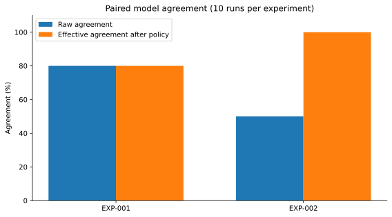

# Local Strands Decider versus Amazon Bedrock

**Compared systems:** local Strands Decider 2B v21 versus Bedrock Amazon Nova Micro (`us.amazon.nova-micro-v1:0`, `us-east-2`). These are **different models**; no independent ground-truth label set was available.

| Experiment | Raw agreement | Effective agreement | Local guardrail overrides | Bedrock guardrail overrides |
|---|---:|---:|---:|---:|
| EXP-001 | 8/10 (80%) | 8/10 (80%) | 0 | 0 |
| EXP-002 | 5/10 (50%) | 10/10 (100%) | 4 | 8 |

EXP-001: the local model returned `Insufficient Evidence` for LB-01 in both campaigns, whereas Bedrock returned `Maintain`. Other raw decisions matched. EXP-002: both providers' **effective** recommendations became `Insufficient Evidence` because the structured SLA state was `NOT_EVALUATED`; this is a guardrail outcome, not proof of model equivalence.

Some Bedrock narrative text refers to an SLA passing even when the structured state says `NOT_EVALUATED`. **Structured evidence and the deterministic guardrail take precedence over generated explanations.** Bedrock confidence was not calibrated; do not fabricate confidence percentages.

The source comparison is `reports/comparison/comparison_by_run.csv`. The per-run details and limitations are in [Results](../experiments/RESULTADOS_Y_ESTADISTICAS.md). No monetary savings or automatic infrastructure actions were demonstrated.
